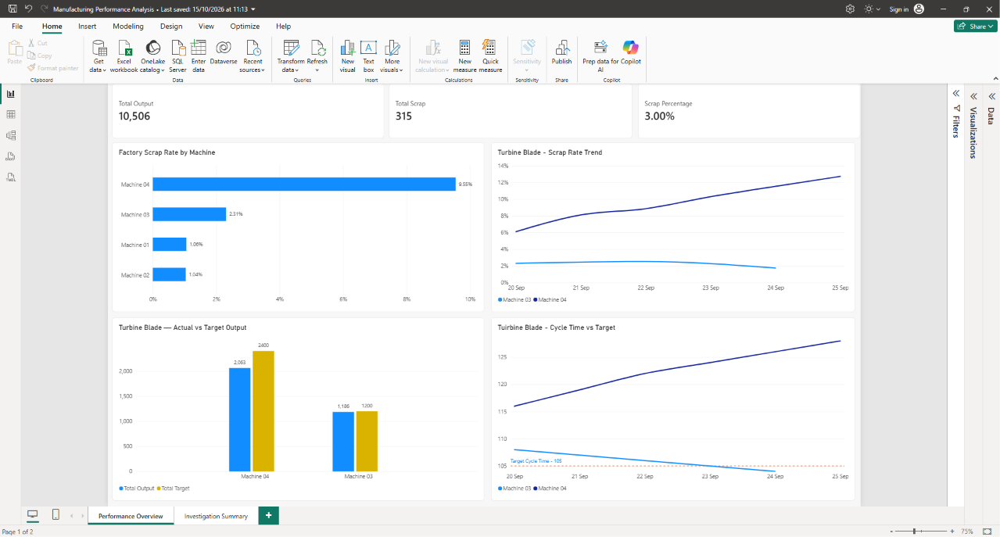
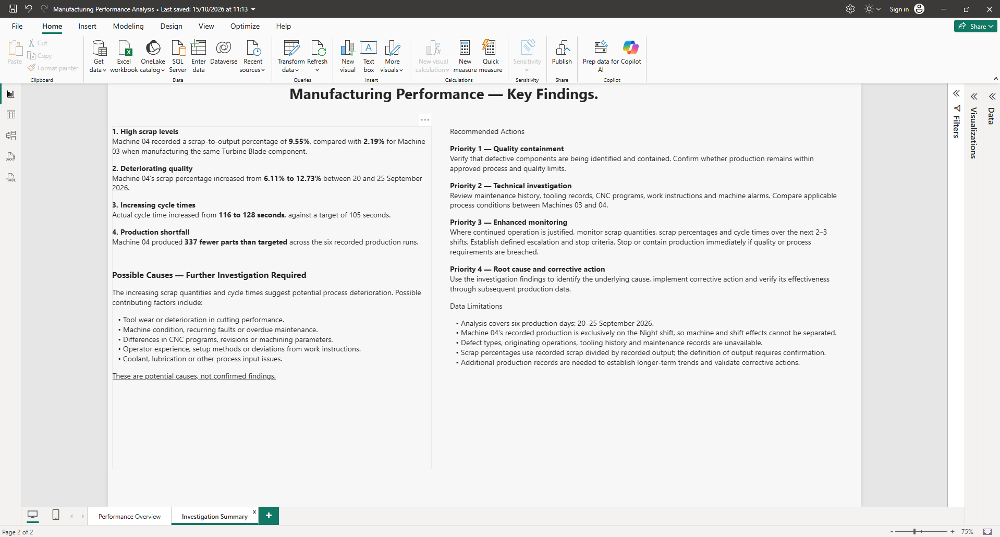

# manufacturing-performance-analysis
This project was carried out to develop my practical skills and experience in SQL and Power BI.
Using simulated manufacturing production data, I analysed production performance, identified potential quality issues and developed a Power BI dashboard to present the findings and recommended actions.

**The tools used during this project were:**
- SQL Server / SSMS: Querying, filtering, joining and analysing manufacturing production data.
- Power BI: Creating an interactive dashboard to visualise production performance and investigate manufacturing quality trends

**The key findings were:**
- High scrap levels: Machine 4 recorded a scrap-to-output percentage of 9.55%, compared with 2.19% for Machine 3, despite both machines manufacturing the same Turbine Blade component.
- Increasing scrap and cycle times: Between 20 and 25 September, Machine 4's scrap-to-output percentage increased from 6.11% to 12.73%, while its cycle time increased from 116 to 128 seconds.
- Production shortfall: Machine 4 failed to meet its production target on all six days, producing 337 fewer parts than planned. The daily shortfall generally increased over the period.

**Recommendations**
- Quality Containment
Verify that defective components are identified and contained. Confirm that production remains within approved quality and process limits.

- Technical Investigation
Review maintenance history, tooling records, CNC programmes, work instructions and machine alarms. Compare manufacturing conditions between Machines 3 and 4 to identify potential differences.

- Enhanced Monitoring
If continued production is justified, monitor scrap levels and cycle times over the next 2–3 shifts, with clearly defined escalation and stop criteria.

- Root Cause and Corrective Action
Identify the underlying cause, implement corrective actions and verify their effectiveness using subsequent production data.

**Power BI Dashboard**

**Investigation Summary**

